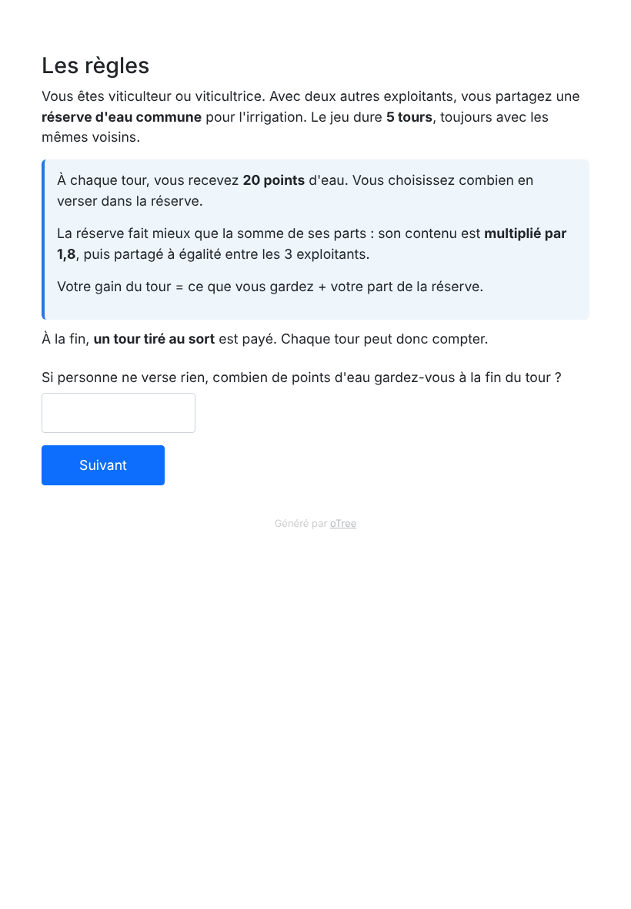
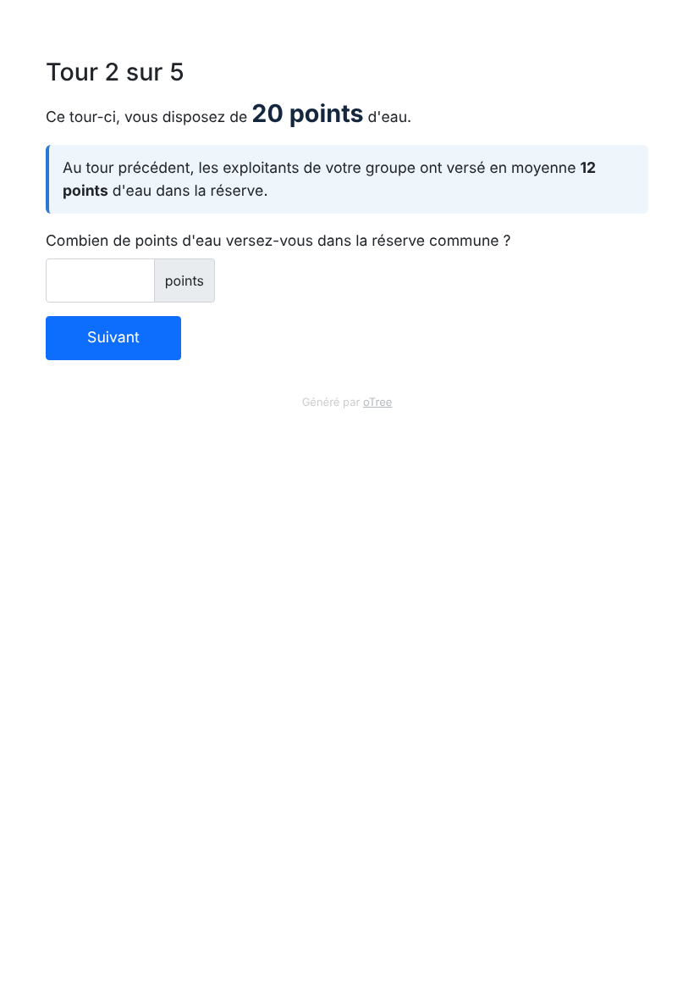
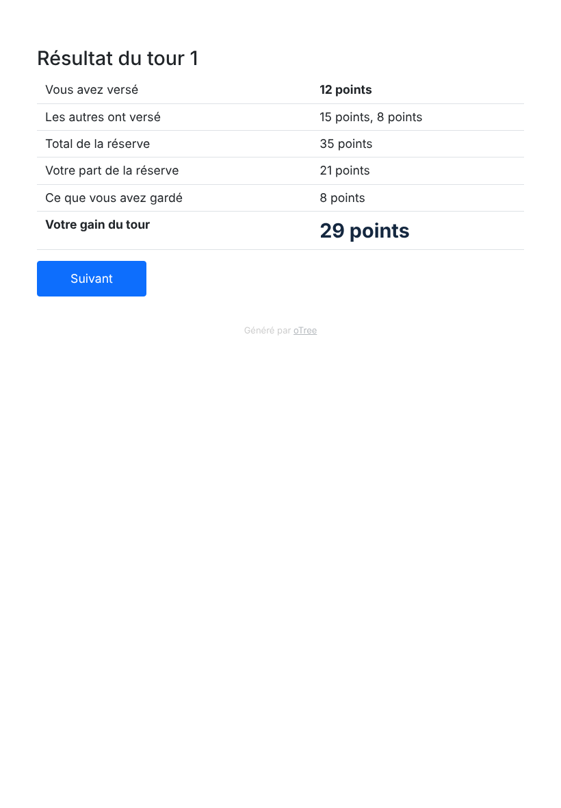

# L'eau partagée : un jeu de bien commun en oTree

Expérience d'économie comportementale prête à être utilisée **en laboratoire, en ligne ou sur le terrain (tablettes)**.
Trois viticulteurs partagent une réserve d'eau pour l'irrigation : à chaque tour, chacun décide combien verser dans la réserve commune. C'est un **jeu de bien public** classique, présenté dans un cadre concret pour des participants non spécialistes.

| Règles | Décision (avec information sur le groupe) | Résultat du tour | Fin |
|---|---|---|---|
|  |  |  |  |

## Protocole

- Groupes de **3**, fixes sur **5 tours**, formés au hasard au début.
- Dotation de **20 points d'eau** par tour ; la réserve est **multipliée par 1,8** puis partagée à égalité.
- **Deux conditions** (deux configurations de session) :
  - `irrigation_base` : chacun ne voit que ses propres résultats ;
  - `irrigation_norme` : à partir du tour 2, chacun voit la contribution moyenne de son groupe au tour précédent (norme sociale).
- Consentement obligatoire, **test de compréhension** bloquant, questionnaire final.
- **Un tour tiré au sort est payé**, plus une participation fixe (paramétrable).
- Le temps de chaque décision est enregistré pour le **contrôle qualité**.
- Deux salles prévues : `labo` (tablettes) et `terrain`.

## Lancer en local

```bash
pip install -r requirements.txt
otree devserver
```
Puis ouvrir http://localhost:8000 et choisir une des deux sessions de démo.

## Tests automatiques

Des bots jouent des parties complètes et vérifient les règles : consentement obligatoire, mauvaise réponse au test de compréhension refusée, contribution limitée à la dotation, calcul exact des gains, un seul tour payé.

```bash
otree test irrigation_base 6
otree test irrigation_norme 6
```
Ils tournent à chaque `push` grâce à GitHub Actions (`.github/workflows/tests.yml`).

## Déployer sur une machine virtuelle Linux (Docker)

```bash
cp .env.example .env          # puis choisir de vrais mots de passe
docker compose up -d db
docker compose run --rm web otree resetdb --noinput   # une seule fois
docker compose up -d
```
oTree tourne avec **PostgreSQL** ; les données restent dans un volume Docker.

**Supervision** : la base et le serveur ont chacun un *healthcheck*, et Docker redémarre automatiquement un service qui tombe. L'état se vérifie avec `docker compose ps` (colonne *STATUS* : `healthy`).
Sauvegarde quotidienne de la base, avec rotation sur 30 jours :

```bash
crontab -e
0 2 * * * cd /chemin/vers/otree-bilbo && ./backup.sh
```

## Données et analyse

Dans l'interface d'administration, **Data → irrigation (custom)** exporte une ligne par décision :
`session, participant, round, group, condition, contribution, group_total, round_gain, paid_round, decision_seconds`.

```bash
pip install pandas matplotlib
python analysis/analyse.py irrigation_custom.csv
```
Le script signale les lignes suspectes (valeurs hors bornes, décisions trop rapides, temps manquant), puis calcule la contribution moyenne par tour et par condition et trace le graphique.

## Structure

```
irrigation/        l'application oTree (logique, pages, tests)
analysis/          contrôle qualité et premiers résultats
docs/              captures d'écran
Dockerfile, docker-compose.yml, backup.sh   déploiement
```

Auteure : Eya Adouni
